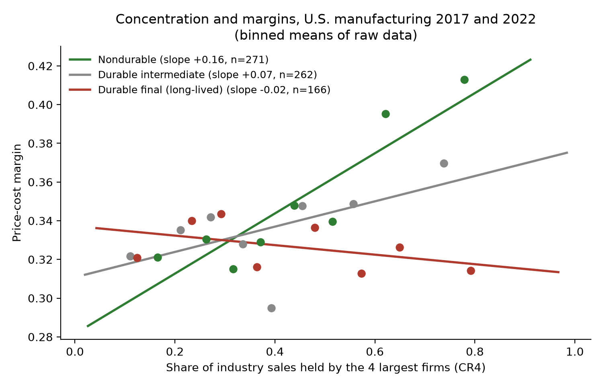
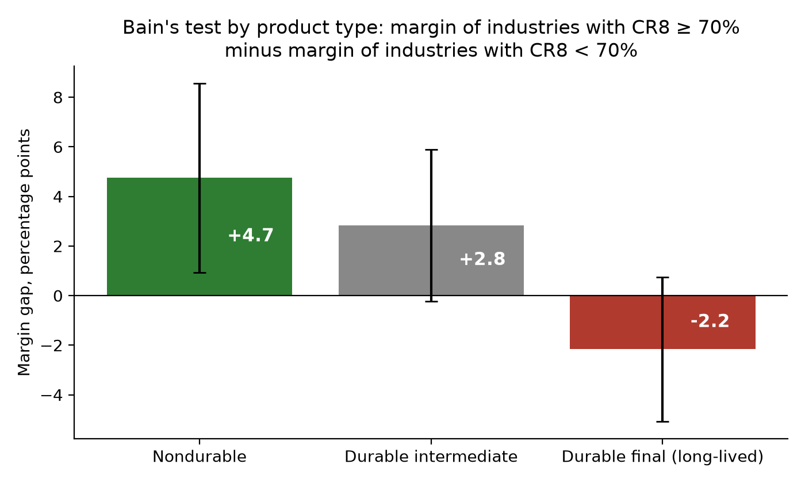
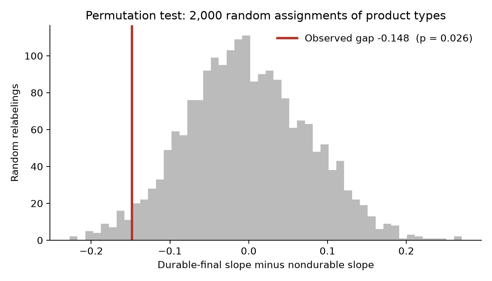
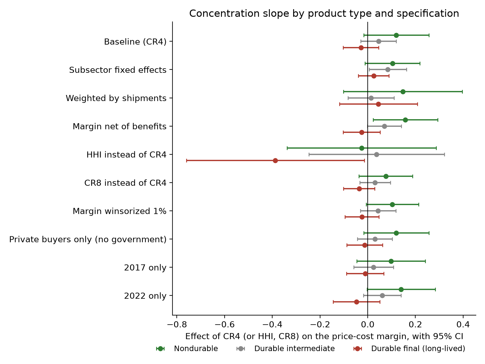
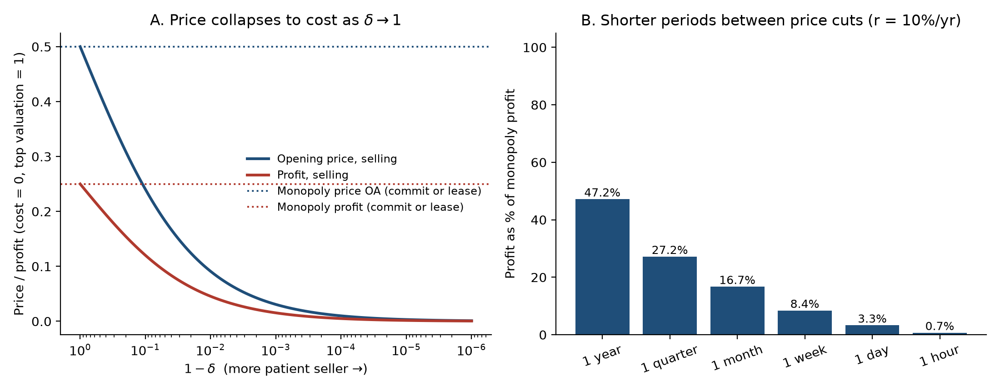

# Does Durability Weaken Monopoly? Testing Coase (1972) on U.S. Manufacturing

Ronald Coase argued in 1972 that a firm selling a durable good cannot hold a monopoly price for long, because it ends up competing with the units it has already sold and with the price cuts its buyers expect it to make. If he was right, market concentration should do less to raise prices in industries that make long-lived goods than in industries whose products are used up. This repository tests that prediction on every U.S. manufacturing industry in the 2017 and 2022 Economic Censuses, and pairs the test with simulations of the underlying theory. Everything runs from public data with one command.

In nondurable industries, higher concentration goes with clearly higher price-cost margins, which is the classic pattern Joe Bain documented in 1951. In industries making long-lived goods bought by households and equipment investors, the relationship is flat. The gap between the two slopes is −0.15 (p = 0.06 with clustered standard errors, p = 0.03 in a permutation test), and it has the predicted sign in all ten specifications I ran, although it is statistically significant in only some of them. Durable intermediate goods, such as parts and materials that are used up inside other products, fall in between, as the theory suggests they should.



## Research question and hypotheses

Coase's argument is about commitment. A monopolist that sells a good lasting forever would like to restrict supply, but once the first buyers have paid, it gains by selling more, and buyers who anticipate this refuse to pay the monopoly price. The simulations in this repository show the effect is large. A seller who can change its price once a month keeps only 17 percent of the monopoly profit, and one who can change it weekly keeps 8 percent (see [the theory section](#the-theory-behind-the-test)). The empirical question is whether this shows up in real industry data.

I test three hypotheses.

- **H1 (Bain).** Among nondurable industries, more concentrated industries earn higher price-cost margins.
- **H2 (Coase).** The concentration-margin slope is flatter for durable-goods industries.
- **H3.** The flattening is strongest for long-lived goods held by final owners, which is the case Coase described, and weaker for durable intermediate inputs.

## Data

| Source | What it provides |
|---|---|
| Census Bureau, Economic Census 2017 and 2022, *Concentration of Largest Firms* | Share of sales held by the 4, 8, 20 and 50 largest firms, and the Herfindahl-Hirschman Index, for each 6-digit NAICS industry |
| Census Bureau, Economic Census 2017 and 2022, *Manufacturing Summary Statistics* | Shipments, payroll, fringe benefits, value added, gross depreciable assets |
| Bureau of Economic Analysis, 2017 detailed Use table | Where each product goes, which identifies goods bought by final owners rather than by other industries |

The sample covers 360 industries in 2017 and 346 in 2022, which together account for about $5.5 trillion and $7.0 trillion of shipments. The files are downloaded directly from the Census and BEA servers with no API key, and their SHA-256 hashes are recorded in [`data/processed/manifest.json`](data/processed/manifest.json) so anyone can confirm they are using the same inputs.

## Method

The outcome is the Collins-Preston price-cost margin, the standard industry-level measure of markup used in this literature.

$$\text{PCM} = \frac{\text{value added} - \text{payroll}}{\text{shipments}}$$

Industries are sorted into three groups. *Nondurable* and *durable* follow the Census Bureau's official M3 definitions by 3-digit NAICS. A durable industry is classed as *durable final* when at least half of its domestic use, according to the BEA Use table, goes to household consumption or to equipment investment. Those are the buyers who keep a durable good as a stock. The remaining durable industries are *durable intermediate*.

The main specification pools both census years and estimates a separate concentration slope for each group,

$$\text{PCM}_{it} = \alpha_g + \beta_g\,\text{CR4}_{it} + \gamma\,\frac{K}{S}_{it} + \delta \log S_{it} + \tau_t + \varepsilon_{it}$$

where *K/S* is gross depreciable assets over shipments, which controls for the return to capital that is included in the margin, *S* is shipments, and τ is a year effect. Standard errors are clustered by industry. H2 and H3 predict β for durable final goods to be below β for nondurables.

## Results

### Main estimates

| Group | Concentration slope (SE) |
|---|---|
| Nondurable | 0.120 (0.070) |
| Durable intermediate | 0.045 (0.038) |
| Durable final (long-lived) | −0.029 (0.038) |
| **Durable final minus nondurable** | **−0.148 (p = 0.059)** |
| Durable (all) minus nondurable | −0.107 (p = 0.139) |

N = 699 industry-years. To put the slopes in context, moving a nondurable industry from a four-firm share of 20 percent to 80 percent is associated with a margin about 7 percentage points higher. The same move in a long-lived durable industry is associated with no increase at all.

### Bain's original test, split by product type

Bain compared industries above and below an eight-firm share of 70 percent. Repeating his comparison within each group gives the clearest picture in the data.



| Group | Margin gap, CR8 ≥ 70% vs. < 70% (SE) |
|---|---|
| Nondurable | +4.7 points (1.9) |
| Durable intermediate | +2.8 points (1.6) |
| Durable final (long-lived) | −2.2 points (1.5) |

Highly concentrated nondurable industries earn margins nearly five points above the rest. Highly concentrated long-lived durable industries earn slightly less than their unconcentrated peers.

### Permutation test

With only a few hundred industries, conventional standard errors can be unreliable, so I also randomly reassigned the three product-type labels across industries 2,000 times and re-estimated the gap each time. A gap as negative as the one observed came up in 2.6 percent of the random assignments.



### Robustness

The durable-final slope sits below the nondurable slope in every specification. The difference is significant at the 10 percent level in six of the ten and at 5 percent in two, so the evidence is consistent but not overwhelming.



| Specification | Final minus nondurable | p |
|---|---|---|
| Baseline (CR4) | −0.148 | 0.059 |
| 3-digit subsector fixed effects | −0.079 | 0.233 |
| Weighted by shipments | −0.102 | 0.501 |
| Margin net of fringe benefits | −0.183 | 0.020 |
| HHI instead of CR4 | −0.362 | 0.147 |
| CR8 instead of CR4 | −0.112 | 0.089 |
| Margin winsorized at 1% | −0.127 | 0.054 |
| Private buyers only (excludes government purchases) | −0.133 | 0.092 |
| 2017 only | −0.108 | 0.192 |
| 2022 only | −0.187 | 0.032 |
| Within-industry change, 2017 to 2022 | −0.196 | 0.090 |

The subsector fixed-effects version is the weakest, since it compares only industries within the same 3-digit group and throws away much of the variation. The shipment-weighted version is dominated by a handful of very large industries, such as motor vehicles, petroleum refining and pharmaceuticals.

Full tables are in [`results/empirics/summary.md`](results/empirics/summary.md), with machine-readable versions alongside.

## Who controls the concentrated durable markets

Census data identifies industries rather than firms, but it shows where control is concentrated. These are the most concentrated long-lived durable industries in 2022, using the private-buyer definition.

| Industry | Top-4 share | Firms | Shipments ($bn) | Margin |
|---|---|---|---|---|
| Ammunition (except small arms) | 87% | 37 | 4.2 | 0.51 |
| Computer storage devices | 84% | 38 | 4.7 | 0.21 |
| Aircraft | 84% | 234 | 92.8 | 0.24 |
| Motor homes | 83% | 58 | 7.4 | 0.22 |
| Heavy duty trucks | 76% | 84 | 33.1 | 0.18 |
| Small arms ammunition | 75% | 151 | 5.8 | 0.40 |
| Burial caskets | 75% | 62 | 0.7 | 0.33 |
| Travel trailers and campers | 71% | 575 | 27.6 | 0.24 |
| Major household appliances | 70% | 123 | 23.7 | 0.38 |
| Batteries | 69% | 234 | 28.2 | 0.39 |

Several of these, including aircraft, heavy trucks and motor homes, have four-firm shares above 75 percent and margins well below the manufacturing average of about 0.34, which is the pattern Coase's argument predicts. Ammunition shows why the official durable classification is imperfect. Census counts it as durable even though it is used up, and it has one of the highest margins on the list.

## Interpretation and limitations

The results fit Coase's prediction. Concentration is associated with higher margins where goods are consumed, and not where goods last and accumulate in buyers' hands. Several caveats apply.

1. **This is a cross-industry correlation, not a causal estimate.** Long-lived durable industries may differ from nondurable ones in other ways that flatten the concentration slope, such as more import competition, more powerful business buyers, or greater sensitivity to the business cycle.
2. **The price-cost margin is an accounting measure.** It includes returns to capital, advertising and R&D, not only market power. The capital control and the benefits-adjusted margin address part of this.
3. **National concentration ratios ignore imports and regional markets**, so they overstate concentration in some industries and understate it in others.
4. **The durable classification is coarse.** It works at the level of whole industries and inherits quirks such as ammunition counting as durable.
5. **2022 was an unusual year**, with post-pandemic supply shortages and high inflation. The result holds in 2017 alone with the same sign but is not significant there.

Natural next steps are to add import penetration from Census trade data, advertising and R&D intensity, a continuous measure of product service life from BEA depreciation rates, and earlier censuses (2002, 2007, 2012) to build a longer panel.

## The theory behind the test

The `src/coase/dynamic.py` and `src/coase/durability.py` modules solve two standard models of durable-goods monopoly. Their main results motivate the hypotheses above.

| Result | Value |
|---|---|
| Opening price of a durable monopolist, as a share of the monopoly price, with yearly / monthly / weekly price changes (10% interest) | 47% / 17% / 8% |
| Two-period profit from selling vs. leasing a fully durable good (Bulow 1982) | 0.45 vs. 0.50 |
| Durability chosen by a selling monopolist when unit cost is low (c < 0.2) | Below the efficient level |



The formal derivations are in [`paper/technical-paper.md`](paper/technical-paper.md). A plain-language essay on the paper, the industries involved and what is at stake is in [`docs/essay.md`](docs/essay.md).

## Reproduce

Requires Python 3.10 or later. The exact package versions used are pinned in `requirements-lock.txt`.

```bash
git clone https://github.com/brendynbeasley/coase-durability-monopoly.git
cd coase-durability-monopoly
python -m venv .venv && source .venv/bin/activate
pip install -r requirements-lock.txt && pip install -e .
make all
```

`make all` downloads the raw files (about 25 MB), builds `data/processed/industry_panel.csv`, runs the simulations and the empirical analysis, writes every table and figure, and runs the 31 tests. The full run takes under a minute after the download. The processed panel is committed, so `make results` and `make test` also work without downloading anything.

## Repository layout

```
src/coase/
  data.py          download Census and BEA files, build the industry panel
  empirics.py      hypotheses, regressions, robustness, permutation test
  dynamic.py       infinite-horizon durable-goods monopoly (Coase conjecture)
  durability.py    two-period selling vs. leasing and choice of durability
  static.py        Coase's Figures I and II
scripts/
  build_data.py        raw files -> data/processed/industry_panel.csv
  run_empirics.py      empirical tables and figures 5-8
  run_experiments.py   theory tables and figures 1-4
data/processed/    industry panel and manifest of source files with hashes
results/           theory results and results/empirics/
figures/           all charts
paper/             technical paper
docs/essay.md      plain-language essay
tests/             model and data tests
```

## References

- Bain, J. S. (1951). Relation of Profit Rate to Industry Concentration: American Manufacturing, 1936–1940. *Quarterly Journal of Economics*, 65(3), 293–324.
- Bulow, J. (1982). Durable-Goods Monopolists. *Journal of Political Economy*, 90(2), 314–332.
- Bulow, J. (1986). An Economic Theory of Planned Obsolescence. *Quarterly Journal of Economics*, 101(4), 729–749.
- Coase, R. H. (1972). Durability and Monopoly. *Journal of Law & Economics*, 15(1), 143–149. [JSTOR](https://www.jstor.org/stable/725018)
- Collins, N. R., & Preston, L. E. (1969). Price-Cost Margins and Industry Structure. *Review of Economics and Statistics*, 51(3), 271–286.
- Gul, F., Sonnenschein, H., & Wilson, R. (1986). Foundations of Dynamic Monopoly and the Coase Conjecture. *Journal of Economic Theory*, 39(1), 155–190.
- Stokey, N. (1981). Rational Expectations and Durable Goods Pricing. *Bell Journal of Economics*, 12(1), 112–128.
- U.S. Census Bureau. 2017 and 2022 Economic Census. https://www.census.gov/programs-surveys/economic-census.html
- U.S. Bureau of Economic Analysis. Input-Output Accounts, 2017 detailed Use table. https://www.bea.gov/industry/input-output-accounts-data

The original Coase paper is not included because it is under copyright.

## License

Code is released under the MIT License. Census and BEA data are public domain.
