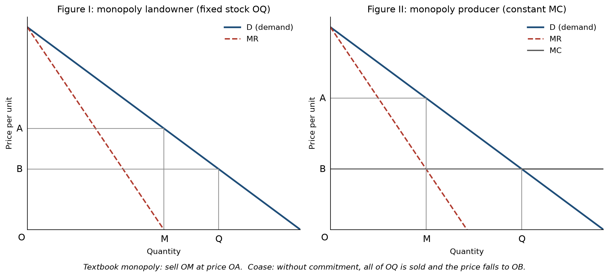
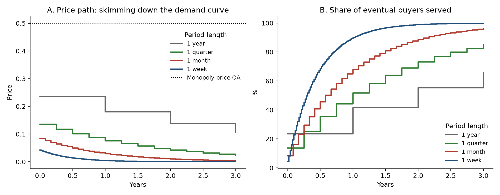
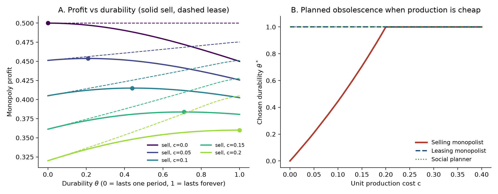

# Who Controls the Things That Last

*An essay on Ronald Coase's "Durability and Monopoly" (1972), with simulations I built to test it and a look at the industries where his idea is playing out now.*

By Brendyn Beasley

---

On October 14, 2025, Microsoft stopped sending security updates to Windows 10. Nothing happened to the computers that morning. They started up, opened files and connected to the internet the way they had the day before. What changed was their future. Analysts estimated that somewhere between 200 and 240 million of those machines did not meet the hardware requirements for Windows 11, so their owners were left to pay for extended updates, keep using an unprotected computer, or buy a new one. Microsoft explained the decision in terms of security, and there is a real security case for it. It is also a very old economic story, and the clearest account of it was written more than fifty years ago, long before anyone was selling software.

Ronald Coase published "Durability and Monopoly" in the *Journal of Law and Economics* in 1972. It is seven pages long, with two diagrams and no equations. Coase won the Nobel Prize in 1991 for other work, and this short note tends to get lost next to his famous papers on the nature of the firm and the problem of social cost. I think it deserves more attention than it gets, because it explains something most people sense without being able to name. It explains why so many companies that make things built to last seem so determined to make sure you never quite own them.

In what follows I explain what a monopoly is and how economists measure one, walk through Coase's argument and the simulations I wrote to test it, and then look at the industries where the argument is being acted out today, who controls them, by how much, and what that means for the people buying from them.

## What a monopoly is

In the strict sense, a monopoly is a market with one seller. Economists use the word more loosely for any firm with enough control over its market to hold the price above what the product costs to make without losing all its customers. A wheat farmer has no such power. If she asks a cent more than the going price, buyers go to the next farm. Microsoft, Apple, John Deere and De Beers are in a different position. Their customers may complain, but most of them stay.

The simplest measure of that power comes from the economist Abba Lerner, who looked at the gap between the price and the marginal cost, which is what it costs to make one more unit.

$$L = \frac{P - MC}{P}$$

In a perfectly competitive market L is zero, because competition pushes the price down to cost. A product that sells for $100 and costs $40 to make has an L of 0.6, so 60 cents of every dollar is markup. The index has a tidy link to customer behavior. A firm maximizing its profit sets L equal to 1/|ε|, where ε is the price elasticity of demand, so the less willing customers are to walk away when the price goes up, the bigger the markup the firm can hold.

Joe Bain, one of the founders of industrial organization as a field, came at the question from another direction in 1951. Instead of measuring markups, he asked whether industries dominated by a few firms earned more money. He sorted 42 American manufacturing industries by the share of output held by their eight largest firms. Where those eight controlled more than 70 percent of the market, profit rates between 1936 and 1940 averaged 11.8 percent. Where they controlled less, the average was 7.5 percent, and a good deal of the later economics of antitrust grew out of trying to explain that gap.

Regulators today mostly use the Herfindahl-Hirschman Index, which adds up the square of each firm's market share. A market split evenly among a hundred firms scores 100, and a pure monopoly scores 10,000. The Justice Department's 2023 merger guidelines treat anything above 1,800 as highly concentrated. Commercial aircraft show how quickly the number climbs. In 2025 Airbus delivered 793 large jets and Boeing delivered 600, which gave Airbus about 57 percent of deliveries and Boeing about 43 percent. The index is 57² + 43², or roughly 5,100, nearly three times the line the government draws.

There is good evidence that this kind of power has been growing across the economy. Jan De Loecker, Jan Eeckhout and Gabriel Unger estimated in 2020 that the average American public company, weighted by sales, charged prices 21 percent above marginal cost in 1980 and 61 percent above it by 2016. Most of the rise came from the firms at the top. The typical company changed little while the largest ones pulled far ahead.

## Coase's puzzle

Almost everything economists say about monopoly assumes the product gets used up. Bread is eaten, gasoline is burned, and the customer comes back next week for more. Coase asked what happens when the product lasts forever.

His example was deliberately extreme. Suppose one person owns all the land in the United States. Land does not wear out, every acre is assumed to be the same, and the owner has no use for it himself, so all he wants is to sell it for as much as he can. The textbook answer is that a monopolist restricts supply to push up the price. In Coase's first figure, the owner sells the quantity OM at the high price OA and keeps the rest, MQ, off the market. If all of it were sold, the price would fall to OB, the price a competitive market would produce.



Coase saw the flaw in that plan. Suppose the owner does sell OM at price OA. He is now holding MQ, land he could turn into money. His only reason for keeping it off the market was that more land for sale would push the price down, but the land that would lose value now belongs to the people who bought it from him. The loss would be theirs, so he sells some more. The same reasoning then applies to whatever is left, and it keeps applying until every acre is gone. If selling costs nothing, Coase wrote, the whole process would take place "in the twinkling of an eye."

Buyers can see this coming, and nobody will pay OA for an acre today if they know the owner will be selling for less soon. So the man who owns every acre in the country, with no competitors at all, ends up charging close to the competitive price, because the only competitor that matters is the version of himself who will be selling again in a few months.

Economists now call this the Coase conjecture, and the problem at the center of it is commitment. The monopolist would be better off if he could promise to hold back, but nobody would believe him, because once the first buyers have paid, keeping the promise no longer serves him. Coase showed the same logic holds for any durable good made in a factory. A company selling machines that never wear out is competing with every machine it has already sold, and with every price cut its customers expect it to make.

## Testing the argument

Coase made his case in words and pictures. Economists later proved versions of it formally, most notably Nancy Stokey in 1981 and Faruk Gul, Hugo Sonnenschein and Robert Wilson in 1986. I wanted to watch the argument work in actual numbers, so I wrote a simulation in Python. The code is in this repository along with tests that check it against results already published in the literature.

The setup is plain. A single seller faces a population of buyers who each value the product at some amount between $0 and $100, spread evenly across that range. The product lasts forever and costs nothing to make, and each buyer wants one. The seller names a price, everyone who thinks it is worth paying buys, and then the seller names a new price for whoever is left. Everyone understands the game, including the fact that the seller cannot bind itself to future prices.

Everything turns on the buyer's choice between buying now and waiting. Someone who values the product at *v*, facing a price *p* today and expecting a price *p′* next period, buys today only if

$$v - p \geq \delta\,(v - p')$$

where δ measures how much a dollar next period is worth today. When the seller can change its price often, δ is close to 1, because next period is not far off. Working the game through gives a clean formula for the first price the monopolist can charge.

$$p_0 = \$100 \times \frac{\sqrt{1-\delta}}{1+\sqrt{1-\delta}}$$

A seller that could commit would charge $50 and sell to everyone who values the product above that. The table shows what happens when it cannot, with money earning 10 percent a year.

| How often the seller can cut its price | First price | Profit compared with a true monopoly |
|---|---|---|
| Once a year | $23.58 | 47% |
| Once a quarter | $13.58 | 27% |
| Once a month | $8.35 | 17% |
| Once a week | $4.20 | 8% |
| Once a day | $1.63 | 3% |
| Once an hour | $0.34 | 0.7% |

The faster prices can move, the less the monopoly is worth. A seller who can reprice every hour, as almost any online store can, keeps less than one percent of the profit a monopolist with the power to commit would earn, which is about as close to Coase's twinkling of an eye as a calculation can get.


The price does not fall all at once. The seller works its way down the demand curve, selling first to the people who want the product most and then cutting the price for the next group. With weekly price changes about 90 percent of the eventual buyers have bought within a year, and nearly all of them paid well under $50.



## How sellers get their power back

Coase did not expect monopolists to accept this, and he listed the ways out. Each of them comes down to finding some way to make a promise of restraint believable.

A seller can promise in writing not to sell any more, or offer to buy the product back later at a high price. If it would have to repurchase everything at the monopoly price, flooding the market would cost it money, and buyers can trust that it will not happen. A seller can also lease the product instead of selling it. A firm that rents out what it makes still owns every unit, so any price cut hurts its own income, the temptation to flood the market disappears, and it can charge the monopoly price period after period. Finally, a seller can make the product wear out sooner. A good that has to be replaced every few years never builds up into a large stock that competes with new sales, and customers keep coming back to buy again, which makes selling look a great deal like leasing.

To test the last two ideas I added a second model, based on Jeremy Bulow's work from the 1980s. In a two-period version of the market, a monopolist that sells a fully durable product earns a profit of 0.45 in the model's units, and one that leases the same product earns 0.50. Leasing is worth 11 percent more for no reason other than that it solves the commitment problem. These are the figures Bulow published in 1982, which gave me one way of confirming the code was right.

The durability result is more interesting, because it depends on cost. When I let the seller choose how long its product lasts, it built the product to wear out early whenever making a new unit was cheap. When production was expensive it chose full durability, because replacements cost real money. The switch happens when a new unit costs about a fifth of what the keenest customer would pay to use the product for a single period. Below that point the seller deliberately makes something worse than it could. A leasing firm, and a planner trying to do the most good for everyone, chose the longest-lasting product in every case.



That cost threshold turned out to be the most useful thing the simulation told me. Software, digital textbooks, music and film cost almost nothing to copy. In the model, a seller whose marginal cost is near zero prefers a product that lasts a single period, which in plain terms is a subscription. It surprised me that a framework Coase built to think about land and machinery lands so squarely on the way software, textbooks and media are sold today.

## Who is doing this now

Coase was working through a thought experiment, but every strategy he described can be found in today's markets, often in the hands of the firms that lead their industries.

Leasing has a long history in antitrust law. The United Shoe Machinery Corporation leased its shoe-making machines to factories and refused to sell them, and in 1953 a federal court found that this lease-only policy helped it keep an illegal monopoly. The Supreme Court upheld the ruling the following year. IBM and Xerox also leased much of their equipment for decades, and economists including Bulow have pointed to both as examples of Coase's logic in practice.

The subscription is the modern lease. In 2013 Adobe announced it would stop developing its boxed Creative Suite and moved its design software to monthly subscriptions. In 2024 the Federal Trade Commission and the Justice Department sued the company, alleging that it hid an early termination fee equal to half the remaining payments on its most popular plan and made cancelling difficult. Adobe disputes the claims. HP, the world's largest printer maker, now offers a plan in which customers rent the printer itself along with the ink. Its chief executive, Enrique Lores, has said the company's long-standing goal is to turn printing into a subscription business and that many of its printers lose money when sold outright. A printer that is sold has to compete with every used printer on the market, while a rented one stays on HP's books.

College textbooks may be the clearest case of all. A 2021 federal court opinion put the share of the new-textbook market held by Pearson, McGraw Hill and Cengage at 80 to 90 percent. Even if the three split that evenly, the Herfindahl index would be about 2,400. For decades their main competition was the used book, the same title they had already sold, coming back each semester to undercut them at the campus store, which is very nearly the problem Coase described. The publishers' answer has been "inclusive access," in which students pay through tuition or course fees for digital materials that expire when the course ends, so there is nothing left to resell to next semester's class.

Planned obsolescence is harder to prove, because companies usually have real reasons for the changes they make. In 2020 Apple agreed to pay up to $500 million to settle claims that software updates had slowed older iPhones. Apple said the slowdown kept aging batteries from shutting the phones off, and it admitted no wrongdoing. Microsoft justified the end of Windows 10 on security grounds, and the stricter hardware rules for Windows 11 have security reasons behind them too. Whatever the motive, the effect matches what the model predicts. Hundreds of millions of working machines lost their software support on a date chosen by the company that made the software.

Control over repair is a quieter way of controlling durability. Deere & Company built about 60 percent of the combines produced in North America in recent years and sells roughly half the region's large tractors. In January 2025 the FTC, joined by Minnesota and Illinois, sued Deere, alleging that it keeps the software tools needed for full repairs out of the hands of farmers and independent mechanics so that the work has to go through its dealers. A federal judge declined to throw the case out in June 2025, and Deere has called the suit baseless. When only the manufacturer can fix a machine, the manufacturer has a great deal of say over how long that machine lasts.

De Beers is the historical example of the commitment strategy. For much of the twentieth century it controlled between 80 and 90 percent of the world's supply of rough diamonds. Diamonds are close to indestructible, which makes them a perfect Coase problem, since every diamond ever sold could in principle compete with a new one. De Beers kept stockpiles off the market and spent heavily on advertising, including the 1947 slogan "A Diamond Is Forever," which encouraged people to keep their diamonds rather than sell them, since a healthy resale market would have undercut the company's own sales. Its share of the market by value has since fallen to around a third.

Some of the most concentrated durable-goods markets show where Coase's conjecture stops applying. Airbus and Boeing together deliver almost every large passenger jet in the world and have a combined backlog of about 8,750 aircraft. They are not much troubled by Coase's problem, because planes wear out, air travel keeps growing, and the backlog acts as a commitment of its own, since neither company could flood the market if it wanted to. The Dutch firm ASML is the only company that makes the extreme ultraviolet lithography machines used to produce the most advanced chips, at roughly $200 million or more per machine. It can only build a limited number each year, and each new generation makes the previous one less valuable. Coase himself noted that rising production costs and growing demand weaken his result, and these two industries are what that looks like in practice.

Coase's own example, land, is one of the least concentrated markets there is. According to the Land Report, the largest private landowner in the United States in 2025 was the family of Red Emmerson, whose company Sierra Pacific Industries holds about 2.4 million acres of timberland. John Malone held about 2.2 million and Ted Turner about 2 million. The country has around 2.3 billion acres, so the largest private owner holds roughly a tenth of one percent of it. Coase never suggested anyone owned it all. He picked land because it made the logic easy to follow.

## What is at stake

I take three lessons from all of this, and each of them reaches well beyond economics.

The first is about what it means to own something. Coase showed that a monopolist selling something durable gives up most of its power the moment it makes the sale. It follows that a monopolist has every reason not to sell, and to rent instead, or to sell something that will not last, or to hold on to the software and the repairs. When a product you used to buy becomes a product you rent, you may pay less up front, but you lose the protection ownership gave you, which was the seller's inability to change the terms on something already in your hands, and over many purchases that adds up to a real shift of power from the people who buy things to the companies that make them.

The second is about waste. The planned-obsolescence result in my simulation is more than a transfer of money from customers to companies, because it destroys value outright. A monopolist that builds its product to fail early spends real resources making replacements that a competitive market or a sensible planner would never have made. A working computer sent to recycling because its software support ran out is a small, physical example of that loss.

The third is about how we judge market power. A firm with 90 percent of a durable-goods market may have far less power than that number suggests, because its biggest rival is its own past output. The practices that restore its power, such as lease-only contracts, subscriptions, repair restrictions and short product lives, can look like ordinary business choices. Coase was careful to say that they often have innocent explanations. Leasing can shield customers from risk, and a less durable product is sometimes cheaper to make. He also said they may be essential to holding a monopoly at all. Telling the two apart is one of the harder problems in antitrust, and the cases against Deere and Adobe, along with the fight over textbooks, are all versions of it.

Coase ended his paper by observing that these arrangements are costly and that some cannot be enforced for long, so a lone seller may still end up with the competitive outcome. That conclusion depends on the seller being unable to escape. Fifty years on, with digital products that cost nothing to copy, software that can switch a feature off from far away, and subscriptions for everything from printers to heated car seats, escaping has never been easier, and the question Coase asked about a man who owned all the land has become a question about who really owns the things in our homes.

---

## For the technical reader

The formal models, derivations and checks are written up in [paper/technical-paper.md](paper/technical-paper.md). In brief, the infinite-horizon model solves the stationary linear equilibrium for uniform valuations and matches the known closed form λ = 1/(1+√(1−δ)) to nine decimal places, and a brute-force value iteration confirms the seller has no profitable deviation. The two-period model reproduces Bulow's (1982) selling and leasing profits and is extended to let the seller choose durability θ ∈ [0, 1] at unit cost *c*.

```
src/coase/
  static.py       Coase's Figures I and II with linear demand
  dynamic.py      Infinite-horizon durable-goods monopoly
  durability.py   Two-period selling, leasing and durability choice
scripts/run_experiments.py   Produces every figure and table
tests/            23 tests against closed forms and published results
results/          CSV output and a summary table
```

To reproduce everything, which takes about 15 seconds on a laptop:

```bash
python -m venv .venv && source .venv/bin/activate
pip install -e ".[test]"
pytest
python scripts/run_experiments.py
```

## Sources

The original paper is not included in this repository because it is under copyright. It can be read through [JSTOR](https://www.jstor.org/stable/725018).

**Economics**

- Coase, R. H. (1972). Durability and Monopoly. *Journal of Law & Economics*, 15(1), 143–149.
- Bain, J. S. (1951). Relation of Profit Rate to Industry Concentration: American Manufacturing, 1936–1940. *Quarterly Journal of Economics*, 65(3), 293–324.
- Bulow, J. (1982). Durable-Goods Monopolists. *Journal of Political Economy*, 90(2), 314–332.
- Bulow, J. (1986). An Economic Theory of Planned Obsolescence. *Quarterly Journal of Economics*, 101(4), 729–749.
- De Loecker, J., Eeckhout, J., & Unger, G. (2020). The Rise of Market Power and the Macroeconomic Implications. *Quarterly Journal of Economics*, 135(2), 561–644.
- Gul, F., Sonnenschein, H., & Wilson, R. (1986). Foundations of Dynamic Monopoly and the Coase Conjecture. *Journal of Economic Theory*, 39(1), 155–190.
- Stokey, N. (1981). Rational Expectations and Durable Goods Pricing. *Bell Journal of Economics*, 12(1), 112–128.
- U.S. Department of Justice and Federal Trade Commission (2023). *Merger Guidelines*.

**Industry facts**

- Aircraft deliveries, 2025: [Forecast International](https://flightplan.forecastinternational.com/2026/01/15/airbus-and-boeing-report-december-2025-commercial-aircraft-orders-and-deliveries/)
- Windows 10 end of support: [TechSpot](https://www.techspot.com/news/107214-microsoft-emails-windows-10-users-recommending-recycling-or.html), [Windows Central](https://windowscentral.com/software-apps/windows-10/microsoft-addresses-the-elephant-in-the-room-discusses-upcoming-end-of-windows-10-support)
- FTC v. Deere: [DTN](https://www.dtnpf.com/agriculture/web/ag/equipment/article/2025/01/15/two-states-join-ftc-federal-lawsuit), [DTN on the June 2025 ruling](https://www.dtnpf.com/agriculture/web/ag/equipment/article/2025/06/11/federal-court-rejects-deeres-motion)
- Deere's share of combines and tractors: [Power Systems Research](https://www.powersys.com/2023/12/datapoint-north-america-production-combines/), [PYMNTS](https://www.pymnts.com/cpi-posts/monopolizing-the-digital-agricultural-information-market-john-deeres-nefarious-right-to-repair-scheme/)
- Textbook publishers and inclusive access: [2021 court opinion](https://www.steptoe.com/a/web/n7UXYHQEFgrgg9UfznZ1Pn/3ZFDLL/20210614-inclusive-access-opinion-dismissing-retailer-claims.pdf), [Inside Higher Ed](https://www.insidehighered.com/news/2017/11/07/inclusive-access-takes-model-college-textbook-sales)
- FTC and DOJ v. Adobe: [CBS News](https://www.cbsnews.com/news/adobe-ftc-federal-lawsuit-cancel-subscription)
- HP printer subscriptions: [TechRadar](https://www.techradar.com/pro/worlds-biggest-printer-company-wants-you-to-stop-buying-printers-rent-them-like-cars-is-what-hp-reckons-you-should-do), [The Register](https://www.theregister.com/2024/03/07/hp_ink_addicts/)
- Apple battery settlement: [BGR](https://bgr.com/tech/iphone-batterygate-apple-settlement-500-million/)
- De Beers market share: [Israeli Diamond Industry](https://en.israelidiamond.co.il/diamond-articles/world/market-share-of-de-beers/)
- ASML: [Tom's Hardware](https://www.tomshardware.com/tech-industry/semiconductors/asmls-planned-low-na-euv-machine-price-hikes-reportedly-frustrate-tsmc-lithography-machine-maker-comes-knocking-to-make-bank-on-tsmcs-profitable-fabs-potentially-costing-the-taiwanese-chipmaker-billions)
- Largest landowners: [Land Report 100, 2025](https://prnewswire.com/news-releases/land-report-unveils-americas-100-largest-landowners-for-2025-302349690.html)
- United Shoe Machinery: [Hanover Shoe v. United Shoe Machinery, 392 U.S. 481](https://law.justia.com/cases/federal/us/392/481/)

## License

Code is released under the MIT License. See `LICENSE`.
