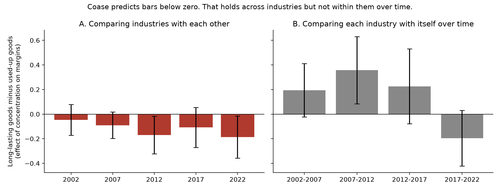

# Can You Monopolize Something That Lasts?

### In 1972, Ronald Coase argued that a company selling something durable ends up competing with itself. I tested the idea on twenty years of American manufacturing data.

---

Four companies make 84% of the aircraft built in the United States, and Boeing alone accounts for most of the large passenger jets. Four companies, led by Thor Industries and Berkshire Hathaway's Forest River, make 83% of the country's motor homes. Whirlpool, GE Appliances and two others make 70% of its major household appliances, from refrigerators to washing machines. Each of these is a market most economists would call highly concentrated, and by the usual logic each should be unusually profitable.

They aren't. After paying for materials and wages, aircraft makers keep about 24 cents of every sales dollar, motor home makers about 22 cents and heavy truck makers about 18 cents, all below the manufacturing average of 34 cents. Industries just as concentrated but selling things that get used up look very different. Tobacco companies keep 84 cents of every dollar, brewers 51 cents and cereal makers 35 cents.

Ronald Coase, who later won the Nobel Prize, offered an explanation for this kind of pattern half a century ago. This project tests whether he was right.

---

## Coase's idea

Most of what economists say about monopoly assumes the product gets used up. Cereal is eaten and gasoline is burned, so a company that controls the market can keep the price high and its customers will keep coming back.

Coase asked what happens when the product lasts. His example was a single person who owns all the land in the country. The textbook answer is that he should sell only part of it at a high price and hold the rest back. Coase saw the flaw. Once the first buyers have paid, the owner is still holding valuable land, and selling more of it would only lower the value of land that now belongs to someone else. So he keeps selling, at lower and lower prices. Buyers can see this coming, and nobody pays a high price today when they can wait for a lower one tomorrow. The owner of every acre in the country ends up charging close to the competitive price, because his real competitor is himself a few months later.

The same logic applies to anything durable, from airplanes to refrigerators. Every machine a company has already sold competes with the next one, and every price cut its customers expect pulls today's price down.

A simulation of Coase's argument shows how large the effect can be. Imagine a product that buyers value at anywhere up to $100, which a company that could promise never to cut its price would sell for $50.

| How often the seller can cut its price | First price it can charge | Profit compared with a true monopoly |
|---|---|---|
| Once a year | $23.58 | 47% |
| Once a month | $8.35 | 17% |
| Once a week | $4.20 | 8% |

Companies have ways around this, and Coase listed them. They can lease instead of sell, so that any price cut hurts their own rental income. They can promise to buy products back at a high price. Or they can make products that wear out, so customers have to return. Car leases, software subscriptions and printers rented by the month are modern versions of the same idea. The [longer essay](docs/essay.md) in this repository goes through these strategies and the companies using them.

---

## Measuring concentration and margins

Concentration is measured the way the Census Bureau measures it.

> **Four-firm concentration ratio (CR4)** = sales of the 4 largest companies ÷ total sales of the industry

Profitability is measured with the price-cost margin, the share of each sales dollar left after paying for materials, energy and wages.

> **Margin** = (value of what the industry makes − materials and energy − payroll) ÷ sales

A margin of 0.34 means that out of every $1 of sales, 34 cents is left to pay for equipment, research, advertising, interest, taxes and profit. Joe Bain showed in 1951 that more concentrated industries tend to have higher margins. If Coase was right, that should hold for goods that get used up and fade away for goods that last.

---

## How I tested it

I collected every manufacturing industry in the five Economic Censuses from 2002 to 2022, about 2,000 industry-years covering $27 trillion of output, and sorted each one into three groups.

| Group | Examples | Share of 2022 output |
|---|---|---|
| Goods that get used up | Food, beverages, fuel, chemicals, paper | 52% |
| Durable parts and materials | Steel, semiconductors, bolts, engine parts | 27% |
| Long-lasting goods owned by buyers | Cars, aircraft, appliances, furniture, machinery | 21% |

The split between the last two groups comes from government input-output tables, which show whether a product ends up in a household or a business's equipment, where it is kept for years, or inside another product. Coase's argument is about the first case.

I then asked how much a rise in concentration raises margins in each group, and checked whether the answer holds up after accounting for import competition, advertising spending and research spending.

---

## Concentration pays for goods that get used up, not for goods that last

Among industries whose products get used up, the more concentrated ones earn clearly higher margins. Going from an industry where the top four companies hold 20% of sales to one where they hold 80% is associated with a margin about 7 cents higher on every sales dollar. For long-lasting goods, the same jump in concentration is associated with almost no change at all.

Bain's own test, which compares industries above and below his 70% line, shows the same thing.

| | Industries where the top 8 hold 70% or more | Everyone else | Gap |
|---|---|---|---|
| Goods that get used up | 37.6¢ | 33.3¢ | 4.3¢ |
| Durable parts and materials | 34.1¢ | 32.8¢ | 1.3¢ |
| Long-lasting goods | 32.9¢ | 33.0¢ | −0.1¢ |

*Margin per dollar of sales, all five censuses pooled.*

On $1 billion of sales, a gap of 4.3 cents comes to $43 million a year. For long-lasting goods, the most concentrated industries earn no more than anyone else.

The industries themselves show the contrast.

| What you know it as | Top 4's share | Who leads the industry | Margin |
|---|---|---|---|
| **Goods that get used up** | | | |
| Cigarettes and tobacco | 91% | Altria, Reynolds American | 84¢ |
| Breakfast cereal | 87% | General Mills, Kellogg's, Post, Quaker | 35¢ |
| Corn syrup and starch | 80% | ADM, Cargill, Ingredion | 31¢ |
| Beer | 64% | Anheuser-Busch, Molson Coors | 51¢ |
| **Long-lasting goods** | | | |
| Airplanes | 84% | Boeing, by a wide margin | 24¢ |
| Motor homes | 83% | Thor Industries, Forest River, Winnebago | 22¢ |
| Heavy trucks | 76% | Paccar, Daimler Truck, Volvo | 18¢ |
| Major appliances | 70% | Whirlpool, GE Appliances | 38¢ |
| Cars and light trucks | 58% | GM, Ford, Stellantis, Toyota | 20¢ |

*2022 Economic Census. The Census does not name companies; the names are each industry's well-known leaders.*

The pattern isn't perfect. Soybean processing is highly concentrated (ADM, Bunge and Cargill) and earns only 15 cents, and appliance makers do better than the other durable industries. Across hundreds of industries, though, the difference between the groups is large and consistent.

---

## Imports, advertising and research don't explain it

The most obvious alternative explanation is foreign competition. Long-lasting goods face far more of it than goods that get used up. Imports supply about 37% of what Americans buy in a typical long-lasting goods industry, against 16% for goods that get used up, and a domestic company with 80% of American production may face plenty of competition from abroad.

Accounting for imports makes the gap larger, not smaller. The same is true of advertising and research spending, which differ a great deal between industries and show up in measured margins. With all three accounted for, the difference between the two groups grows by about half, and its p-value, the usual measure of how easily a result like this could appear by chance, falls to about 0.01. In a separate check, I randomly reshuffled which industries counted as durable 2,000 times, and a gap as large as the real one appeared less than 2% of the time.

---

## It's a difference between industries, not a change within them

Comparing different industries with each other has a weakness, because a cereal maker and an aircraft maker differ in many ways besides durability. So I also compared each industry with itself, asking whether margins rose in industries that became more concentrated between one census and the next.

Here the pattern reverses. When long-lasting goods industries consolidated, their margins rose at least as much as in other industries, and between 2002 and 2017 they rose more. The reversal is strongest from 2007 to 2012, the years of the Great Recession. Only in the most recent period, 2017 to 2022, does it point in Coase's direction.

One likely reason is the business cycle. Purchases of cars, appliances and equipment rise and fall far more sharply than purchases of food or fuel, and in a downturn weaker companies close while everyone's margins shrink, so concentration and margins can move together for reasons that have little to do with Coase. That explanation is plausible but the data can't prove it.

What the evidence supports is narrower than "Coase was right." Markets for long-lasting goods are persistently different from markets for goods that get used up, in exactly the way he predicted. Whether that difference comes from his mechanism, or from something else that sets these industries apart, remains open.

---

## Who keeps a product matters more than how long it lasts

If durability is what weakens market power, longer-lasting products should show the effect more strongly. I measured how long each product typically stays in use, from about a year for car parts to nearly twenty for electrical transformers, using government depreciation records. It made no difference. A product that lasts fifteen years shows the same flat relationship between concentration and margins as one that lasts four.

What separates the groups is whether a durable product ends up owned by a household or business that keeps it, or gets built into something else. That fits the heart of Coase's argument, which is about a company competing with the stock of its own products already sitting in customers' hands.

---

## Why it matters

For consumers, the results suggest that a company dominating a market for long-lasting goods has less power over prices than its market share implies, as long as it actually sells its products. That condition matters. Coase's argument implies that such a company has strong reasons to stop selling and start renting, or to make products that wear out, and the same simulations show leasing earns about 11% more than selling and that a company will deliberately make products less durable when production is cheap. Subscriptions for software, printers and car features are the strategies Coase described in 1972.

For antitrust, market share alone is a weak guide in durable-goods markets. Regulators and courts would learn more from asking whether a dominant company can lock in its customers through leasing, repair restrictions or planned obsolescence, because those are the tools that restore the power durability takes away.

---

## Limits of this study

The study compares whole industries rather than companies, and it finds a consistent difference between groups of industries rather than proof of cause, as the within-industry results make clear. The margin measure comes from government statistics and includes spending on equipment, research and advertising as well as profit. Concentration is measured nationally, so it misses regional markets. Some measurements are coarse. Research spending is available only for broad industry groups, import data starts in 2005, and the official durable classification has quirks, such as counting ammunition as durable. Industry codes also change between censuses, so some industries can't be followed over time.

---

## Further reading

[TECHNICAL.md](TECHNICAL.md) covers the data sources, methods, full statistical results and robustness checks, and how to reproduce everything with one command. [paper/technical-paper.md](paper/technical-paper.md) has the formal models and a paper-style write-up, and [results/empirics/summary.md](results/empirics/summary.md) has every table. [docs/essay.md](docs/essay.md) is a longer plain-language essay on Coase's paper and the companies using the strategies he described. A companion project, [Bain (1951) revisited](https://github.com/brendynbeasley/bain-1951-revisited), tests Bain's original question with company financial data.

The original paper is Ronald H. Coase, "Durability and Monopoly," *Journal of Law and Economics*, 1972. All data comes from the U.S. Census Bureau, the Bureau of Economic Analysis and the National Science Foundation, and is public.
