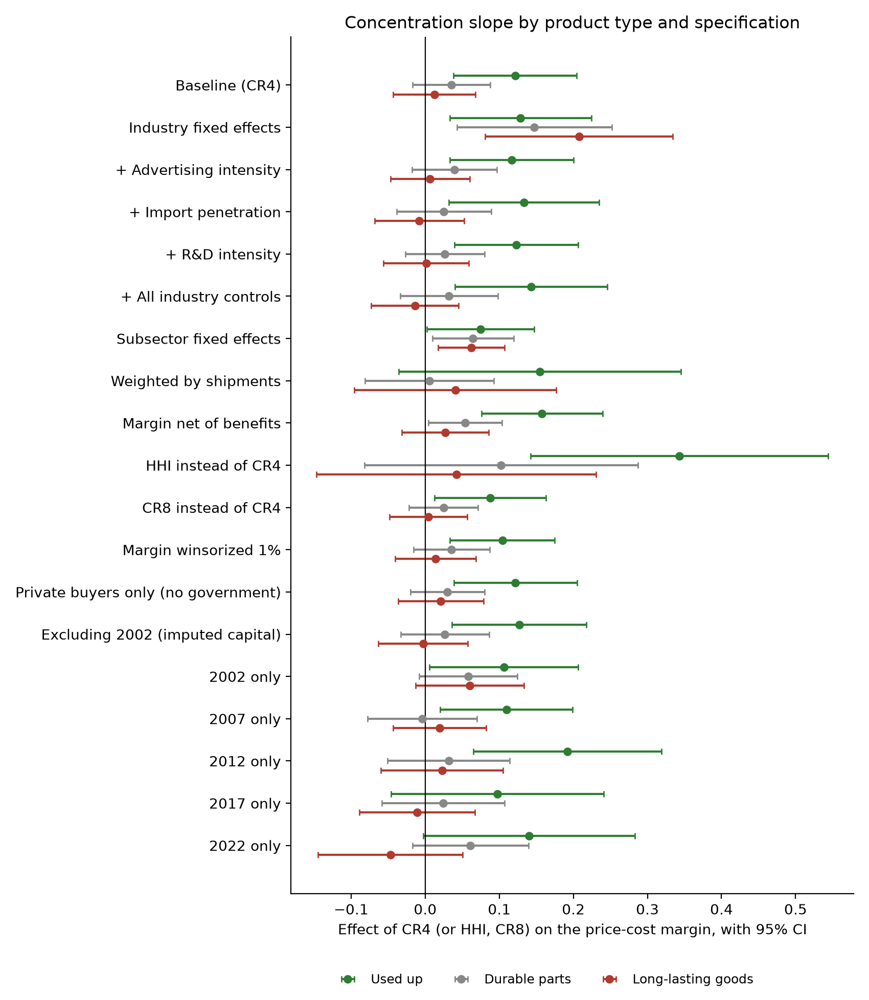

# Technical notes

This file covers the data, methods, full results and reproduction steps behind the [README](README.md). The formal models and a paper-style write-up are in [`paper/technical-paper.md`](paper/technical-paper.md), and every table generated by the code is in [`results/empirics/summary.md`](results/empirics/summary.md).

## Hypotheses

- **H1 (Bain 1951).** Among nondurable industries, more concentrated industries earn higher price-cost margins.
- **H2 (Coase 1972).** The concentration-margin slope is flatter for durable-goods industries, because a durable-goods seller competes with the stock it has already sold and with its own expected price cuts.
- **H3.** The flattening is strongest for long-lived goods held by final owners and grows with the product's service life.

## Data

| Source | Years | What it provides |
|---|---|---|
| Census Bureau, Economic Census, concentration tables | 2002, 2007, 2012, 2017, 2022 | Share of sales held by the 4, 8, 20 and 50 largest firms, HHI, number of firms, by 6-digit NAICS |
| Census Bureau, Economic Census, manufacturing statistics | 2002–2022 | Shipments, payroll, benefits, value added, gross depreciable assets, advertising expense |
| Census Bureau, Related Party Trade files | 2007–2022 | Imports and domestic exports by 6-digit NAICS |
| NSF, Business Enterprise R&D Survey, table 17 | 2017, 2022 | R&D as a share of domestic sales, by industry (3- to 6-digit NAICS) |
| BEA, 2017 detailed Use table | 2017 | Where each product goes, which identifies goods bought by final owners |
| BEA, PEQ and PCE bridge tables and fixed-asset accounts | 2017 | Service life of the equipment and consumer durables each product is sold into |

The panel has 2,014 industry-years, of which 1,982 have complete data for the baseline specification, covering $27 trillion of shipments. All files download from government servers with no API key. Their SHA-256 hashes are recorded in [`data/processed/manifest.json`](data/processed/manifest.json), and the processed panel is committed so results reproduce even if an agency later revises a file.

## Variables

| Variable | Definition |
|---|---|
| Price-cost margin (PCM) | (value added − payroll) / shipments (Collins and Preston 1969) |
| CR4, CR8 | share of shipments of the 4 or 8 largest companies |
| HHI | Herfindahl-Hirschman Index as published by Census (largest 50 companies) |
| K/S | gross depreciable assets / shipments. The 2002 census did not publish assets, so each industry's 2007 value is carried back. |
| Import penetration | imports / (shipments + imports − exports), capped at 1. Industries that trade statistics bundle under a code ending in X, or whose codes differ between trade and census data (for example 336110 in 2022), are pooled at five digits. Missing for 2002. |
| Advertising intensity | advertising expense / shipments |
| R&D intensity | NSF R&D-to-sales ratio, averaged over 2017 and 2022 and matched by longest NAICS prefix; treated as fixed over time |
| Final-owner share | share of domestic use (intermediate plus final uses, excluding exports, imports and inventory change) going to personal consumption plus private and government equipment investment |
| Service life | 1/*d* for each equipment or consumer-durable category, where *d* is depreciation over average net stock in 2017, averaged over the categories a product is sold into with bridge-table weights |

Industries are *nondurable* or *durable* by the Census M3 definition (3-digit NAICS). Durable industries with a final-owner share of at least 0.5 are *durable final*; the rest are *durable intermediate*. BEA measures are matched to census codes by longest NAICS prefix, with a five- and four-digit fallback for codes that changed between vintages.

## Specification

$$\text{PCM}_{it} = \alpha_g + \beta_g\,\text{CR4}_{it} + \gamma\,\frac{K}{S}_{it} + \delta \log S_{it} + \theta' X_{it} + \tau_t + \varepsilon_{it}$$

with g ∈ {nondurable, durable intermediate, durable final}, census-year effects τ, optional controls *X*, and standard errors clustered by 6-digit industry. The test of interest is β<sub>final</sub> − β<sub>nondurable</sub> < 0.

## Main results

| | Baseline | + Import penetration | + Advertising | + R&D | + All controls |
|---|---|---|---|---|---|
| Nondurable slope | 0.121 (0.042) | 0.133 (0.052) | 0.117 (0.042) | 0.123 (0.043) | 0.143 (0.052) |
| Durable intermediate slope | 0.035 (0.027) | 0.025 (0.033) | 0.040 (0.029) | 0.027 (0.027) | 0.032 (0.034) |
| Durable final slope | 0.012 (0.028) | −0.008 (0.031) | 0.007 (0.027) | 0.001 (0.029) | −0.014 (0.030) |
| **Final minus nondurable** | **−0.109 (p = 0.032)** | **−0.141 (p = 0.019)** | **−0.110 (p = 0.028)** | **−0.122 (p = 0.018)** | **−0.157 (p = 0.009)** |
| N | 1,982 | 1,365 | 1,920 | 1,982 | 1,330 |

A permutation test that reassigns the three product groups across industries 2,000 times (labels held fixed within industry across years) gives p = 0.018.

**Bain's 70 percent split (CR8), pooled.** Margin gap between industries above and below the threshold: nondurable +0.043 (0.011), durable intermediate +0.013 (0.009), durable final −0.001 (0.009).

## Within-industry results

| | Gap (durable final minus nondurable) | p |
|---|---|---|
| Industry fixed effects | +0.079 | 0.332 |
| Stacked changes between consecutive censuses (N = 1,419) | +0.180 | 0.010 |
| 2002–2007 | +0.194 | 0.080 |
| 2007–2012 | +0.357 | 0.010 |
| 2012–2017 | +0.226 | 0.146 |
| 2017–2022 | −0.196 | 0.090 |

## Service life

Among durable industries, the CR4 × service-life interaction is −0.0008 per year (SE 0.0061, p = 0.90, N = 942). Mean service life is 7.1 years (SD 3.4), ranging from about 1 year for vehicle parts to 19 years for electrical transformers.

## Robustness



Across 18 cross-industry specifications the gap is negative in every one, significant at 5 percent in 12 and at 10 percent in 14. The specifications are the five in the main table, 3-digit subsector fixed effects, shipment weights, margins net of fringe benefits, HHI or CR8 in place of CR4, margins winsorized at 1 percent, a private-buyer definition of final owners, excluding 2002, and each census year separately. The weakest are subsector fixed effects (−0.012, p = 0.78), which remove most of the variation between durable and nondurable goods, and shipment weights (−0.114, p = 0.33), which concentrate weight on a few very large industries.

## Limitations

1. The estimates are conditional correlations, and the within-industry results show that fixed industry characteristics could drive the cross-industry gap.
2. Accounting margins include returns to capital, advertising and R&D, which the controls address only in part.
3. National concentration ratios ignore regional markets.
4. R&D intensity is coarse and available only from 2015; import penetration is missing for 2002; 2002 capital intensity is imputed from 2007.
5. The M3 durable classification is coarse (ammunition counts as durable), and NAICS codes change between census vintages.

## Theory

`src/coase/dynamic.py` solves the stationary linear equilibrium of the infinite-horizon durable-goods monopoly with uniform valuations and matches the closed form λ = 1/(1+√(1−δ)) to nine decimal places; a brute-force value iteration confirms the seller has no profitable deviation. `src/coase/durability.py` reproduces Bulow's (1982) two-period selling and leasing profits (0.45 and 0.50) and lets the seller choose durability.

## Reproduce

Requires Python 3.10 or later. Exact package versions are pinned in `requirements-lock.txt`.

```bash
git clone https://github.com/brendynbeasley/coase-durability-monopoly.git
cd coase-durability-monopoly
python -m venv .venv && source .venv/bin/activate
pip install -r requirements-lock.txt && pip install -e .
make all
```

`make all` downloads the raw files (about 150 MB), builds `data/processed/industry_panel.csv`, runs the simulations and the empirical analysis, writes every table and figure, and runs the tests. The analysis takes under a minute after the download. Because the processed panel is committed, `make results` and `make test` work without downloading anything.

## Repository layout

```
src/coase/
  data.py          downloads and builds the industry panel (Census, BEA, NSF, trade)
  empirics.py      hypotheses, regressions, robustness, permutation and within-industry tests
  dynamic.py       infinite-horizon durable-goods monopoly (Coase conjecture)
  durability.py    two-period selling vs. leasing and choice of durability
  static.py        Coase's Figures I and II
scripts/
  build_data.py        raw files -> data/processed/industry_panel.csv
  run_empirics.py      empirical tables and figures 5-9
  run_experiments.py   theory tables and figures 1-4
data/processed/    industry panel and manifest of source files with hashes
results/           theory results and results/empirics/
figures/           all charts
paper/             technical paper
docs/essay.md      longer plain-language essay
tests/             model and data tests
```

## References

- Bain, J. S. (1951). Relation of Profit Rate to Industry Concentration: American Manufacturing, 1936–1940. *Quarterly Journal of Economics*, 65(3), 293–324.
- Bulow, J. (1982). Durable-Goods Monopolists. *Journal of Political Economy*, 90(2), 314–332.
- Bulow, J. (1986). An Economic Theory of Planned Obsolescence. *Quarterly Journal of Economics*, 101(4), 729–749.
- Coase, R. H. (1972). Durability and Monopoly. *Journal of Law & Economics*, 15(1), 143–149. [JSTOR](https://www.jstor.org/stable/725018)
- Collins, N. R., & Preston, L. E. (1969). Price-Cost Margins and Industry Structure. *Review of Economics and Statistics*, 51(3), 271–286.
- Gul, F., Sonnenschein, H., & Wilson, R. (1986). Foundations of Dynamic Monopoly and the Coase Conjecture. *Journal of Economic Theory*, 39(1), 155–190.
- Stokey, N. (1981). Rational Expectations and Durable Goods Pricing. *Bell Journal of Economics*, 12(1), 112–128.
- National Center for Science and Engineering Statistics. Business Enterprise Research and Development Survey, 2017 and 2022. https://ncses.nsf.gov
- U.S. Bureau of Economic Analysis. Input-Output Accounts and Fixed Assets Accounts. https://www.bea.gov
- U.S. Census Bureau. Economic Census, 2002–2022, and Related Party Trade. https://www.census.gov
