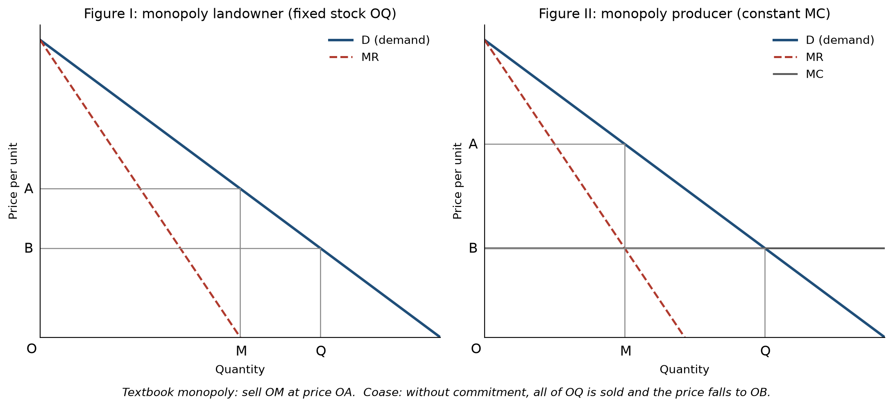
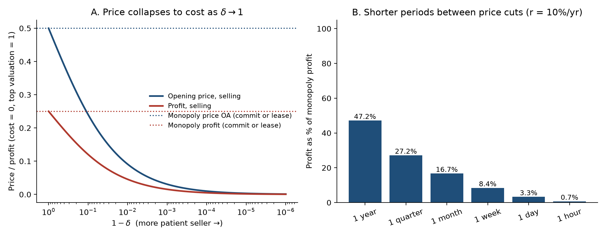
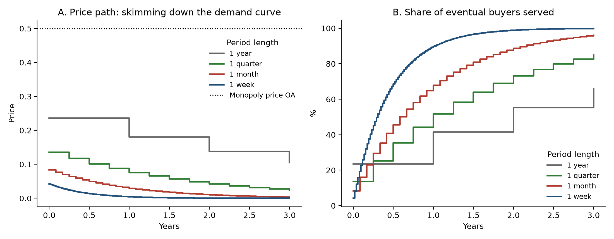
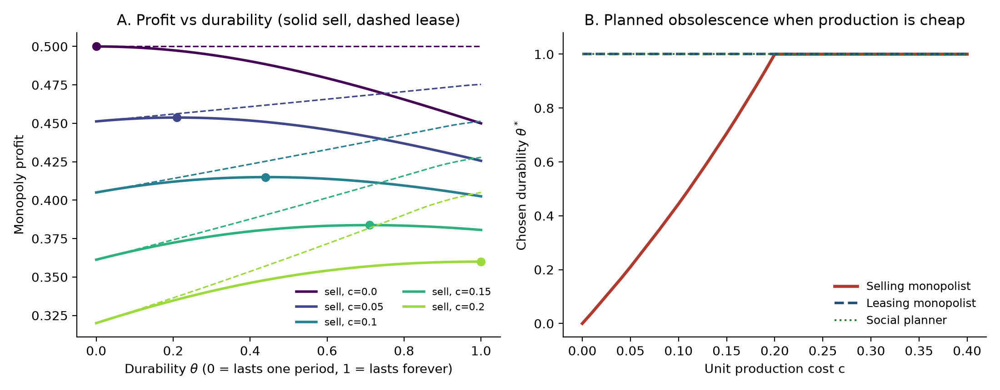

# Durability and Monopoly Revisited, Simulating Coase (1972)

*Technical companion to the empirical study in the [README](../README.md) and the essay in [docs/essay.md](../docs/essay.md).*

## Abstract

Coase (1972) argued that a monopolist selling a perfectly durable good cannot charge the monopoly price. Buyers expect it to keep cutting the price after each round of sales, so the price falls to the competitive level, and does so almost instantly if selling is costless. Coase also proposed ways out: commitment, leasing and reduced durability. This study formalises the argument in two standard models and computes the results.

In an infinite-horizon game with uniform valuations, the seller's opening price is √(1−δ)/(1+√(1−δ)). It falls to cost as the time between price cuts shrinks. With a 10% annual interest rate, profit drops from 47% of the monopoly level with yearly price changes to 0.7% with hourly changes.

In a two-period model, leasing restores the full monopoly profit (0.50 against 0.45 from selling). A selling monopolist that can choose durability builds an inefficiently short-lived good whenever unit production cost is below 0.2, while a lessor and a social planner choose full durability. All four of Coase's main claims hold in these models. The durability result holds only when production is cheap.

I then take the prediction to data. Across 6-digit U.S. manufacturing industries in the five Economic Censuses from 2002 to 2022 (1,982 industry-years), the slope of the price-cost margin on four-firm concentration is 0.121 for nondurable industries and 0.012 for long-lived durable goods bought by final owners. The difference of −0.109 (p = 0.032) grows to −0.157 (p = 0.010) with controls for import penetration, advertising and R&D intensity, and is negative in all 18 cross-industry specifications. The pattern does not appear in within-industry variation: with industry fixed effects or census-to-census changes the durable-final slope is at least as large as the nondurable slope. A continuous measure of product service life built from BEA fixed-asset data has no detectable effect.

## 1. Introduction

Coase's note is eight pages long, contains no equations and has two diagrams. Its argument is simple. A landowner owns all the land in a country, and the textbook monopoly rule says to sell the quantity OM where marginal revenue is zero, at price OA (Figure I). But after OM is sold, the owner still holds MQ and can make more money by selling some of it. The resulting price fall lands on those who already bought. Repeating this logic, the owner ends up selling the entire stock OQ. Buyers who understand this will not pay more than the competitive price OB. In Coase's words, a monopolist of a durable good faces a demand schedule that is "infinitely elastic at the competitive price."

The problem is one of commitment, or time inconsistency. The monopolist would like to promise to restrict supply, but the promise is not credible once the first sales are made. Coase lists several remedies, namely a contractual promise not to sell more, a buy-back guarantee, leasing instead of selling, donating the surplus stock, and making the good less durable.

This study asks whether Coase's claims survive when the argument is written as an explicit game and solved numerically. We answer with three exercises, all reproducible with the code in this repository.

## 2. Model A: the Coase conjecture

**Setup.** A unit mass of buyers has valuations v ~ U[0, 1], where v is the present value of the services of one unit. Each buyer wants at most one unit. The seller has constant marginal cost c, normalised to 0 without loss of generality: the c > 0 case is a rescaling. Prices are set at t = 0, 1, 2, … and both sides discount by δ per period. The seller cannot commit to future prices.

**Equilibrium.** High-valuation buyers buy first, so the state is the highest remaining valuation x. We look for the stationary linear equilibrium (Stokey 1981; Gul, Sonnenschein & Wilson 1986):

- the seller moves the cutoff from x to y = λx and charges p = γx;
- the marginal buyer y is indifferent between buying now and next period:
  y − p = δ(y − γy), which gives p = (1 − δ + δγ)·y;
- the seller's value is W(x) = w·x², and its first-order condition pins down λ.

Solving the three conditions gives λ = 1/(1+√(1−δ)), an opening price p₀ = 1 − λ, and profit p₀/2. The code solves the system numerically and checks it against this closed form (agreement to 1e-9). It also checks by brute-force value iteration that the seller has no profitable deviation.

**Results.** As δ → 1, meaning the seller can cut prices ever more often, the opening price and profit go to zero, which is the competitive outcome (Figure 2A). To give δ a real-world meaning, we set δ = e^(−rΔ) with r = 10% per year and vary the period length Δ:

| Time between price cuts | δ | Opening price | Profit as % of monopoly |
|---|---|---|---|
| 1 year | 0.9048 | 0.236 | 47.2% |
| 1 quarter | 0.9753 | 0.136 | 27.2% |
| 1 month | 0.9917 | 0.084 | 16.7% |
| 1 week | 0.9981 | 0.042 | 8.4% |
| 1 day | 0.9997 | 0.016 | 3.3% |
| 1 hour | 0.99999 | 0.003 | 0.7% |

This is the formal version of Coase's "twinkling of an eye." Figure 3 shows the skimming path. With weekly price changes, about 90% of the eventual buyers are served within a year, at prices far below the monopoly price of 0.5.

**Commitment and leasing.** If the seller can commit (or, equivalently here, offers a buy-back guarantee at the monopoly price), it charges 0.5 and earns 0.25 regardless of δ. A lessor sets a rental price of (1−δ)/2 each period and earns the same present value, 0.25. This confirms Coase's claim that these arrangements restore monopoly power.

## 3. Model B: selling, leasing and durability

To study durability we use a two-period model in the spirit of Bulow (1982, 1986).

**Setup.** In each period, demand for the good's services is P = 1 − S, where S is the stock of services in use. A unit built in period 1 provides 1 unit of service in period 1 and θ ∈ [0, 1] units in period 2. θ = 1 is fully durable, θ = 0 lasts one period. Each new unit costs c to build. The discount factor is δ = 1.

- **Selling.** In period 2 the seller ignores the effect of new sales on the value of units already sold. It sells q₂ = max(0, (1 − θq₁ − c)/2). Period-1 buyers anticipate this, so a unit sells for (1 − q₁) + θ·p₂.
- **Leasing.** The seller keeps ownership and chooses the whole service path, so it absorbs any fall in value.
- **Planner.** Maximises total surplus.

**Results.**

1. *Leasing beats selling.* With θ = 1 and c = 0, selling earns 0.45 (q₁ = 0.4, q₂ = 0.3) while leasing earns 0.50. These are Bulow's (1982) numbers. Leasing weakly beats selling at every θ and c tested.
2. *A one-period good has no durability problem.* At θ = 0 selling and leasing give the same profit, because there is no old stock to devalue.
3. *Planned obsolescence.* When a selling monopolist chooses θ, it trades off two forces. Higher durability saves on production cost, which is efficient. Lower durability reduces the commitment problem, which is what Coase pointed to. The chosen θ* rises smoothly from 0 at c = 0 to 1 at c = 0.2 (Figure 4B). Over this range the selling monopolist builds a good that wears out too early, while the lessor and the planner choose θ = 1. For c ≥ 0.2 the production saving dominates and the seller also chooses full durability.

The third result refines Coase's claim. Reduced durability is a profitable escape only when building new units is cheap relative to what the monopolist loses from the commitment problem.

## 4. Discussion

The simulations support Coase's four main claims. Without commitment, a durable-goods monopolist's price falls toward the competitive level, and it falls faster the more often the seller can change its price. Leasing, commitment and buy-backs restore monopoly profit. Reduced durability can be profitable, though only under some cost conditions.

The models help explain several real business practices, including leasing by firms such as IBM and Xerox in the mid-20th century, buy-back guarantees, "limited editions" that promise a fixed quantity, and frequent new product versions that make old ones obsolete. They also bear on competition policy. A single seller of a durable good may have far less market power than its market share suggests, and practices that look anticompetitive, such as leasing-only contracts, may be the only way such a seller can earn monopoly profit.

The models use linear demand, uniform valuations, a stationary market and constant marginal cost. Coase himself flags three qualifications that are not modelled here. Rising marginal cost spreads production over time. Reputation may matter, since the seller may not want to disappoint buyers' expectations, and Ausubel and Deneckere (1989) show that reputational equilibria can support near-monopoly prices. Growing demand, in the form of new buyers arriving over time, weakens the conjecture (Sobel 1991).

Natural extensions would add a stream of new buyers to Model A, build a multi-period durability model with depreciation, use non-uniform valuation distributions including the "gap" case where cost is below the lowest valuation, and test the predictions on data, for example the speed of price declines for durable products sold by dominant firms.

## 5. Empirical test

**Prediction.** Models A and B imply that a durable-goods seller's market power depends on its ability to commit, not on its market share alone. In a cross-section of industries, this predicts that the slope of the price-cost margin on concentration, positive since Bain (1951), should be attenuated in durable-goods industries, most of all for long-lived goods held by final owners, where the stock of past sales competes directly with new sales.

**Data.** The unit is a 6-digit NAICS manufacturing industry in the 2002, 2007, 2012, 2017 and 2022 Economic Censuses (2,014 industry-years; 1,982 with complete baseline data). Concentration (CR4, CR8, CR20, CR50, HHI) comes from the concentration-of-largest-firms tables; shipments, payroll, benefits, value added, gross depreciable assets and advertising expense from the manufacturing statistics. The 2002 census did not publish assets, so each industry's 2007 capital-to-shipments ratio is carried back. Durable versus nondurable follows the Census M3 definition. The final-owner share is the share of domestic use (intermediate use plus final uses, excluding exports, imports and inventory change) going to personal consumption plus private and government equipment investment, from the BEA 2017 detailed Use table, matched by longest NAICS prefix; durable industries with a share of at least 0.5 are classed as durable final. Import penetration, M/(S + M − X), uses Census related-party trade files (2007–2022), pooling industries that trade statistics bundle under codes ending in X and capping at 1. R&D intensity is the NSF BERD R&D-to-domestic-sales ratio (table 17), averaged over 2017 and 2022 and matched by longest NAICS prefix; it is coarse and treated as time-invariant. Service life is the PEQ- and PCE-bridge-weighted mean of 1/d over the equipment and consumer-durable categories a commodity is sold into, where d is depreciation over average net stock in BEA's 2017 fixed-asset accounts.

**Specification.** With g ∈ {nondurable, durable intermediate, durable final},

PCM_it = α_g + β_g·CR4_it + γ·(K/S)_it + δ·log S_it + θ′X_it + τ_t + ε_it,

where PCM = (value added − payroll)/shipments (Collins and Preston 1969) and X contains the optional controls. Standard errors are clustered by 6-digit industry. The test of interest is β_final − β_nondurable < 0.

**Cross-industry results.** β_nondurable = 0.121 (0.042), β_intermediate = 0.035 (0.027), β_final = 0.012 (0.028); the contrast is −0.109 (p = 0.032). Adding import penetration gives −0.142 (p = 0.019); advertising, −0.110 (p = 0.028); R&D, −0.122 (p = 0.018); all three, −0.157 (p = 0.010, N = 1,318). A permutation test reassigning group labels across industries (2,000 draws, labels fixed within industry across years) gives p = 0.018. Under Bain's 70 percent CR8 threshold, the margin gap between concentrated and unconcentrated industries is +0.043 (0.011) for nondurables, +0.013 (0.009) for durable intermediates and −0.001 (0.009) for durable final goods. Across 18 cross-industry specifications (the above, plus subsector fixed effects, shipment weights, benefits-adjusted margins, HHI or CR8, winsorized margins, a private-buyer definition, excluding 2002, and each census year separately), the contrast is negative in all 18, significant at 5 percent in 12 and at 10 percent in 14. It is weakest with 3-digit subsector fixed effects (−0.012, p = 0.78) and shipment weights (−0.114, p = 0.33).

**Within-industry results.** With 6-digit industry fixed effects, the contrast is +0.079 (p = 0.33). In stacked first differences between consecutive censuses with period effects (N = 1,419), it is +0.180 (SE 0.070, p = 0.010). By period it is +0.194 (2002–07), +0.357 (2007–12), +0.226 (2012–17) and −0.196 (2017–22). The Coase pattern is therefore a feature of cross-industry variation and is not identified from within-industry changes. One interpretation is that the cross-section captures the long-run structural effect while five-year changes are dominated by cyclical co-movement of concentration and margins in durable industries, which are far more cyclical; the data cannot distinguish this from time-invariant omitted industry characteristics.

**Service life.** Among durable industries, the CR4 × service-life interaction is −0.0008 (SE 0.0061, p = 0.90, N = 942; mean life 7.1 years, SD 3.4). Conditional on final-owner status, how long a good lasts does not further flatten the concentration-margin relationship.

**Caveats.** The estimates are conditional correlations. Accounting margins include returns to capital, advertising and R&D; national concentration ratios ignore geographic market definition; the M3 durable classification is coarse (ammunition counts as durable); NAICS codes change across vintages and are matched by identical code or prefix. All code and data needed to reproduce these numbers are in the repository (`make all`).

## References

- Ausubel, L., & Deneckere, R. (1989). Reputation in Bargaining and Durable Goods Monopoly. *Econometrica*, 57(3), 511–531.
- Bulow, J. (1982). Durable-Goods Monopolists. *Journal of Political Economy*, 90(2), 314–332.
- Bulow, J. (1986). An Economic Theory of Planned Obsolescence. *Quarterly Journal of Economics*, 101(4), 729–749.
- Bain, J. S. (1951). Relation of Profit Rate to Industry Concentration: American Manufacturing, 1936–1940. *Quarterly Journal of Economics*, 65(3), 293–324.
- Coase, R. H. (1972). Durability and Monopoly. *Journal of Law & Economics*, 15(1), 143–149.
- Collins, N. R., & Preston, L. E. (1969). Price-Cost Margins and Industry Structure. *Review of Economics and Statistics*, 51(3), 271–286.
- Gul, F., Sonnenschein, H., & Wilson, R. (1986). Foundations of Dynamic Monopoly and the Coase Conjecture. *Journal of Economic Theory*, 39(1), 155–190.
- Sobel, J. (1991). Durable Goods Monopoly with Entry of New Consumers. *Econometrica*, 59(5), 1455–1485.
- Stokey, N. (1981). Rational Expectations and Durable Goods Pricing. *Bell Journal of Economics*, 12(1), 112–128.

## Figures

